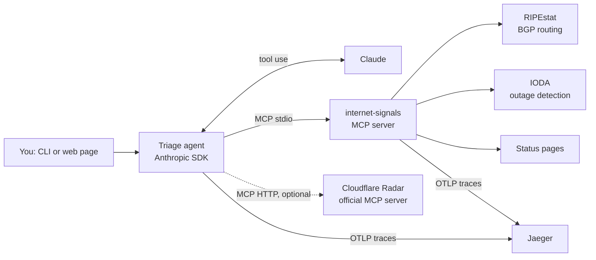

# Upstream: is it us, or is it upstream?

An incident-triage agent for the first ten minutes of an outage. You describe the symptom; it
works outward from the affected network to the country to SaaS vendors using **public internet
data**, then gives a verdict with evidence. Every step is traced with **OpenTelemetry**, so you
can see exactly how the agent reasoned, what it cost, and where it went wrong.

[](https://codespaces.new/YOUR_GITHUB_USERNAME/upstream-triage)
[](https://render.com/deploy?repo=https://github.com/YOUR_GITHUB_USERNAME/upstream-triage)


```
$ upstream replay iberian-blackout
Replaying: Spain & Portugal power blackout (2025-04-28)
It is 2025-04-28T13:00Z. The page says:
> Our Madrid and Lisbon offices both dropped off the VPN around 10:30 UTC...

  → ioda_signal_summary(entity_type='country', entity_code='ES', start='2025-04-28T06:00Z', ...)
  → ioda_signal_summary(entity_type='country', entity_code='PT', start='2025-04-28T06:00Z', ...)
  → ioda_top_outages(start='2025-04-28T09:00Z', end='2025-04-28T13:00Z', ...)
  ...
**Verdict**: ...
── receipt: 31.2s · 5 model calls · 48,210 in / 2,904 out tokens · 9 tool calls, 0 errors
```
*(Illustrative output. Your run will differ.)*

## Why this exists

"Is it us?" is the most expensive question in incident response. Network teams call the answer
*mean time to innocence*: proving quickly that a problem is (or isn't) in your own stack. Much of the
evidence is public. BGP routing tables, internet-wide outage detection and vendor status pages
answer the question; they're just scattered across tools nobody has open at 3 a.m.

This project puts those sources behind an MCP server, gives them to Claude, and instruments the
whole loop so the agent's behavior is observable rather than a black box.

## What's inside



| Piece | What it does |
|---|---|
| `src/upstream/server.py` | **internet-signals MCP server.** 9 read-only tools over RIPEstat, IODA and Statuspage. Returns summaries rather than raw payloads, and also exposes a prompt and a resource. Runs over stdio or Streamable HTTP. |
| `src/upstream/agent.py` | **The agent.** A hand-written tool-use loop with the Anthropic SDK and the MCP Python SDK. Connects to any MCP servers listed in `servers.json`, runs independent tool calls in parallel, and caches the prompt. |
| `src/upstream/scenarios.py` | **Replay mode.** Real past incidents the agent investigates as if they were happening now. |
| `src/upstream/cli.py` | `upstream ask / replay / eval / tools / call` |
| `src/upstream/web.py` | A one-page web UI for the agent (used by the Render deployment). |

The goal was to build a triage workflow on top of existing pieces, not another MCP wrapper. Status-page
MCP servers, an IODA server and Cloudflare's official Radar server already exist. As far as I could
find, the new parts here are the layered triage workflow, BGP data from RIPEstat, historical replay,
and the tracing analysis.

## Quick start (GitHub Codespaces, nothing to install)

1. Add your Anthropic API key as a Codespaces secret named `ANTHROPIC_API_KEY`
   (GitHub > Settings > Codespaces > Secrets), or `export ANTHROPIC_API_KEY=...` in the terminal later.
2. Click **Open in GitHub Codespaces** above. The container installs everything and starts Jaeger.
3. In the terminal:

```bash
upstream replay                      # list the historical scenarios
upstream replay facebook-bgp --show-answer
upstream ask "Users in Brazil say our site has been slow since 14:00 UTC. Our origin is in us-east-1. Is it us?"
```

Then open the **Ports** tab, click **Jaeger traces** (port 16686), choose the `upstream-agent`
service, and open the latest trace.

### Explore without an API key

The MCP server doesn't need a key. Call its tools directly:

```bash
upstream tools
upstream call lookup_network '{"resource": "1.1.1.1"}'
upstream call ioda_outage_events '{"entity_type":"country","entity_code":"ES","start":"2025-04-28T06:00Z","end":"2025-04-29T06:00Z"}'
upstream call service_status '{"service": "github"}'
```

### Running locally instead

```bash
python -m venv .venv && source .venv/bin/activate
pip install -e '.[dev]'
docker run -d --name jaeger -p 16686:16686 -p 4318:4318 jaegertracing/jaeger:2.11.0   # optional
export OTEL_EXPORTER_OTLP_ENDPOINT=http://localhost:4318                                 # optional
export ANTHROPIC_API_KEY=...
upstream replay optus-australia
```

## Replay scenarios

On a normal day nothing interesting is broken, so a live demo is boring. IODA and RIPEstat keep
history, though, so the agent can investigate a real past incident with a simulated "now". Its
system prompt tells it to reason from tool evidence rather than from what it might remember about
the event.

| id | Incident | What a good answer finds |
|---|---|---|
| `iberian-blackout` | Spain & Portugal blackout, 2025-04-28 | Country-wide drop across many networks: not your app |
| `facebook-bgp` | Meta withdraws its routes, 2021-10-04 | BGP update burst from AS32934: Facebook's side, not your DNS |
| `optus-australia` | Optus outage, 2023-11-08 | One ISP (AS4804) down: find it among all Australian networks |
| `not-the-network` | Mass Windows crashes, 2024-07-19 | Internet signals normal: the network is innocent, look at endpoints |

The last one matters most: a triage tool that only ever says "it's the network" is useless.

## Use the MCP server from Claude

**Claude Code:**
```bash
claude mcp add internet-signals -- upstream-signals
```

**Claude Desktop** (`claude_desktop_config.json`):
```json
{ "mcpServers": { "internet-signals": { "command": "upstream-signals" } } }
```
(Use the full path to `upstream-signals` if it isn't on your PATH, e.g. `.venv/bin/upstream-signals`.)

**Claude on the web (remote connector):** deploy to Render (below), then go to Settings > Connectors >
Add custom connector and paste `https://<your-service>.onrender.com/mcp`.

Claude Desktop users also get the `triage` prompt and an `upstream://scenarios` resource.

## Deploy to Render

`render.yaml` is a Render Blueprint with two free web services:

| Service | What people get | Secrets |
|---|---|---|
| `internet-signals-mcp` | A public MCP endpoint at `/mcp` that anyone can add to Claude as a connector | none |
| `upstream-web` | A web page where anyone with the passcode can replay scenarios or ask questions | `ANTHROPIC_API_KEY`, `DEMO_PASSCODE` |

Click **Deploy to Render**, or go to New > Blueprint in the Render dashboard and pick your fork.
Render prompts for the two secrets. The web demo spends your Anthropic credits, so it also has
a `DAILY_LIMIT` (default 25 investigations a day). To deploy only the MCP server, delete the
`upstream-web` block from `render.yaml`.

Free instances sleep when idle, so open the link once before an interview to wake it up.

## Observability: what the traces show


Each investigation is one trace that spans both processes:

```
invoke_agent upstream-triage                    agent      tokens, tool calls, tool errors
├─ chat claude-sonnet-5-5                       agent      input/output/cached tokens, stop reason
├─ execute_tool ioda_signal_summary             agent      marked ERROR if the tool failed
│  └─ MCP send tools/call ioda_signal_summary   MCP SDK    W3C traceparent injected into _meta
│     └─ tools/call ioda_signal_summary         server     (separate process, same trace)
│        └─ GET api.ioda.inetintel.cc.gatech.edu  server   status code, cache hit
├─ execute_tool ioda_top_outages  ...           (parallel tool calls show up as siblings)
└─ chat claude-sonnet-5-5
```

- Span names and attributes follow the OpenTelemetry **GenAI semantic conventions**
  (`invoke_agent`, `chat`, `execute_tool`, `gen_ai.usage.*`). Those conventions are still marked
  *Development*, so names may change.
- The MCP Python SDK (v2) emits the `MCP send` and `tools/call` spans and propagates trace
  context on its own. This project adds the agent-level spans around them and the outbound
  HTTP spans inside the server.
- Prompts and tool payloads are **not** recorded by default. Set
  `OTEL_INSTRUMENTATION_GENAI_CAPTURE_MESSAGE_CONTENT=true` to include them.

**The finding behind the instrumentation:** an MCP tool failure comes back as a *successful*
JSON-RPC response with `isError: true`. So the SDK's transport span stays green even when the tool
failed and the model is now working with an error message. Without an agent-level span that checks
`isError`, failed tools look healthy in your APM. `tests/test_agent.py` reproduces this against
the real SDK over stdio. More in [docs/what-the-traces-showed.md](docs/what-the-traces-showed.md).

## Evals

```bash
upstream eval                       # all scenarios
upstream eval facebook-bgp optus-australia
```

This replays each scenario and grades the answer against a hidden reference diagnosis, using Claude
as the judge. It prints pass, partial or fail alongside latency, tool calls, errors and tokens, so a
prompt or model change shows up in both quality and cost. Choose the model with `--model` or
`UPSTREAM_MODEL`.

## Adding more MCP servers

`servers.json` uses the same shape as Claude Desktop's config, plus `requires_env`. It ships with
Cloudflare's official **Radar** MCP server, which turns on automatically when `CLOUDFLARE_API_TOKEN`
is set. The agent then has Cloudflare's traffic and outage data alongside IODA and RIPEstat, with no
code changes.

## Tests

```bash
pytest -q
```

The tests use recorded API response shapes, so they need no network access or API key. They cover
the tool summaries, error handling, the agent loop with a scripted model, cross-process trace
propagation, and the transport-span finding.

## Data sources and credits

- [IODA](https://ioda.inetintel.cc.gatech.edu/): Internet Outage Detection and Analysis, Georgia Tech
- [RIPEstat](https://stat.ripe.net/): RIPE NCC (requests identify themselves with `sourceapp=upstream-triage`)
- Public [Atlassian Statuspage](https://developer.statuspage.io/) APIs of the listed vendors

These are free public services. The server caches responses for 60 seconds and limits time windows;
please keep it polite.

## Limitations

- Public data shows *macroscopic* events: countries, large networks, major vendors. It won't show
  a single bad link or one customer's Wi-Fi.
- Live-only tools (`bgp_routing_status`, `service_status`) can't look into the past, and Statuspage
  only exposes about the last 50 incidents.
- It's a demo, not an on-call product: no auth on the public MCP endpoint (it's read-only public
  data) and no persistent storage.

## License

MIT
